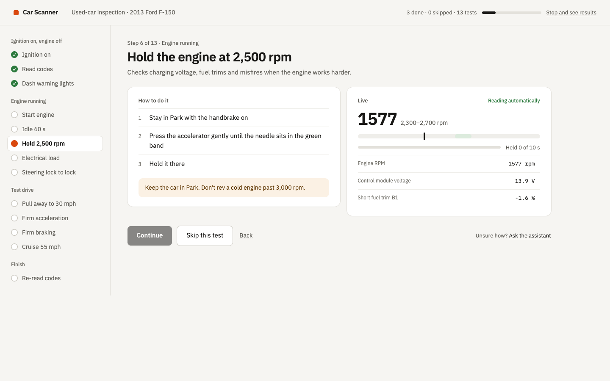

# Car Scanner

Universal car diagnostics for an ELM327-compatible OBD-II adapter (built and tested against the
**vLinker FS USB**). It reads every module, guides you through tests step by step, checks whether the
mileage is genuine, reviews photos of the car, and has an AI assistant (Claude or OpenAI) that uses
each user's own API key.

- **Every module.** Generic OBD-II codes (stored, pending, permanent, freeze frame), plus a UDS/KWP2000
  scan of every diagnostic address on CAN cars: ABS, airbag, body, cluster, gateway and so on.
  Codes are labelled *Active*, *Pending* or *History*.
- **Guided tests.** Built-in plans (used-car inspection, health check, emissions readiness, delivery
  check) or a plan the AI writes for a problem you describe. Each step says why and how. Steps the app
  can measure read live data, including "hold 2,500 rpm for 10 s" with a live meter. Any step can be skipped.
- **Mileage verification.** Compares the reading you type with mileage stored in other modules, mileage
  stamped on past fault codes, engine run hours, earlier scans, service records and wear seen in photos.
  Produces a 0–100 confidence score and lists the evidence.
- **Photo inspection.** A 29-shot guided list (outside, close-ups, inside, under the hood, underneath,
  paperwork). The AI reports repair signs, damage, rust, leaks and wear, and says which shots are missing.
- **Accounts and a garage.** Sign in. Every car you scan is saved with its full history.
- **Assistant.** Chat limited to car diagnostics. It reads the car's data, searches the web, remembers facts
  about each car, and can build guided plans. It can only *ask* to clear codes; you approve in the app.



## Download

**[Download page](https://lordjhamb.github.io/car-scanner/)** · [Latest release](https://github.com/lordjhamb/car-scanner/releases/latest)

| Your computer | File |
|---|---|
| Mac with Apple silicon (M1 or later) | [CarScanner-macOS-AppleSilicon.dmg](https://github.com/lordjhamb/car-scanner/releases/latest/download/CarScanner-macOS-AppleSilicon.dmg) |
| Windows 10 / 11 | [CarScanner-Windows.zip](https://github.com/lordjhamb/car-scanner/releases/latest/download/CarScanner-Windows.zip) |
| Linux (x86_64) | [CarScanner-Linux.tar.gz](https://github.com/lordjhamb/car-scanner/releases/latest/download/CarScanner-Linux.tar.gz) |

Open it and Car Scanner starts in your browser at `http://127.0.0.1:8077`, already signed in. Everything is
stored on your computer (`~/Library/Application Support/Car Scanner` on Mac, `%APPDATA%\Car Scanner` on Windows).

**First launch:** the app isn't signed with a paid certificate yet, so your computer will warn you.
On Mac, right-click the app and choose **Open**. On Windows, choose **More info → Run anyway**. On Windows,
the black window that opens is the app; close it (or use **Quit Car Scanner**) to stop it.

No adapter? Choose **Demo car** when connecting: a simulated 2013 pickup. Pick "Rolled-back mileage"
to see the tampering detection.

## Run from source

Needs Python 3.11+ (this also covers Intel Macs):

```bash
git clone https://github.com/lordjhamb/car-scanner && cd car-scanner
make install          # creates .venv, installs dependencies
make desktop          # personal mode: opens the browser, signs you in automatically
# or: make run        # server mode, with accounts and sign-in
```

**Using the vLinker FS:** plug it into the OBD port, turn the ignition on and connect USB. On macOS it
appears as `/dev/cu.usbserial-…`. If it doesn't, install the FTDI VCP driver.

**AI features:** open **Settings → AI assistant** and paste an Anthropic and/or OpenAI API key. Keys
are encrypted at rest with the server secret and never sent back to the browser.

## Configuration

Settings are environment variables; see [`.env.example`](.env.example). In production you must set
`CARSCAN_SECRET_KEY`, and should set `CARSCAN_ENV=production` and `CARSCAN_SECURE_COOKIES=true` behind HTTPS.

| Variable | Default | Purpose |
|---|---|---|
| `CARSCAN_DATA_DIR` | `data` | SQLite database, uploaded photos, generated dev secret |
| `CARSCAN_SECRET_KEY` | generated in dev | Encrypts users' API keys. Required in production |
| `CARSCAN_ALLOW_REGISTRATION` | `true` | Turn off to stop new sign-ups |
| `CARSCAN_CLAUDE_MODEL` | `claude-opus-5-5` | Default Claude model (users can change theirs) |
| `CARSCAN_OPENAI_MODEL` | `gpt-5` | Default OpenAI model (users can change theirs) |

## Publishing a release

1. Bump the version in `carscan/__init__.py` and `pyproject.toml`.
2. `git tag v0.1.0 && git push origin v0.1.0`

The [Release workflow](.github/workflows/release.yml) runs the tests, builds the Mac, Windows and Linux
apps with PyInstaller on GitHub's machines, test-launches each one and attaches them to a GitHub release.
To build without publishing, run the workflow by hand from the Actions tab.

**Download page:** in the repo's Settings → Pages, choose "Deploy from a branch", branch `main`, folder `/docs`.
It appears at https://lordjhamb.github.io/car-scanner/.

Build the app locally with `make package` (output in `dist/`).

## Testing

```bash
scripts/test.sh
```

This runs `ruff`, the Python suite with coverage (fails under 85 %), a Node syntax check of every
browser module, and the frontend unit tests. Everything runs against the built-in simulator and
scripted AI providers, so no adapter, car, network or API key is needed. CI runs the same script on
Python 3.11–3.13 ([`.github/workflows/ci.yml`](.github/workflows/ci.yml)).

## Project layout

```
carscan/
  obd/          ELM327 transport, OBD-II services, UDS module scan, DTC texts, simulator
  services/     VIN decoding, mileage scoring, guided-plan schema + templates, photo handling
  ai/           Claude provider (Anthropic SDK), OpenAI provider, assistant tools, prompts
  api/          FastAPI routes: auth, garage/scans/mileage, runs/photos/assistant
  adapter.py    owns the single USB adapter (locking, background scans, per-user ownership)
  db.py         SQLite schema and migrations
  security.py   scrypt passwords, session tokens, Fernet encryption, rate limiting
  app.py        app factory, security headers, static frontend
  desktop.py    launcher for the downloadable app (data folder, port, browser, quit)
web/            no-build frontend (ES modules): views, styles, loader animation
packaging/      PyInstaller spec and launcher for the Mac / Windows / Linux builds
docs/           GitHub Pages download page
tests/          pytest suite + node:test frontend tests
```

## How the pieces fit

- **Personal installs** (the downloads): the app listens only on `127.0.0.1` and refuses requests addressed
  to any other host name (blocks DNS-rebinding). It signs the computer's owner in automatically; turn this off
  with `CARSCAN_AUTO_LOGIN=false` on a shared computer. It checks GitHub Releases for a newer version and
  sends nothing else.
- **Sessions:** HttpOnly, SameSite=Lax cookie holding a random token (only its SHA-256 is stored).
  Every state-changing request also needs a custom header and the per-session CSRF token.
- **One adapter, many users:** the adapter belongs to whoever connected it; other accounts get
  "in use" until it is released (disconnect or sign out).
- **AI calls** go through one provider interface. Claude uses the Messages API with adaptive thinking,
  server-side web search and refusal fallbacks. Tool calls run against this user's car data only.
  Anything that changes the car becomes a pending action the user must approve by typing `CLEAR`.

## Limits

- The all-module scan needs CAN (most cars from 2008 on). Older K-line/J1850 cars get generic OBD-II only.
- Module names, odometer DIDs and snapshot layouts are manufacturer-specific. Brand coverage grows in
  `carscan/obd/uds.py` (`KNOWN_11BIT`, `ODO_DIDS`, `SNAPSHOT_ODO_DIDS`). Your own code texts can go in
  `<data dir>/custom_dtcs.json`.
- AI-written plans and photo reports can be wrong. The app says so, shows its sources, and puts
  safety notes on risky steps.

## License

MIT. See [LICENSE](LICENSE).
